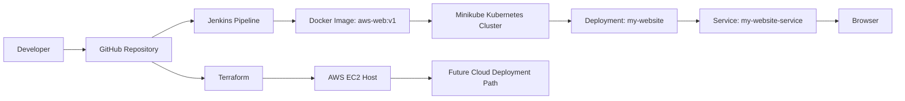

# CodeVerse Academy - AWS Web DevOps Project

<<<<<<< HEAD
=======


A static learning website packaged with Docker and prepared for a DevOps deployment workflow using Jenkins, Kubernetes on Minikube, and Terraform-based AWS EC2 provisioning.

This project is built as a beginner-friendly cloud and DevOps portfolio project. It starts with a responsive static website, then demonstrates how the same application can be containerized, deployed locally to Kubernetes, and extended toward cloud deployment on AWS.

> Current status: the website, Dockerfile, Kubernetes manifests, Jenkins pipeline file, and Terraform EC2 scaffold are present in the repository. Full end-to-end cloud automation should be treated as planned or environment-dependent unless you have verified it in your own setup.

## Preview

<p align="center">
  
  
  
</p>

## Project Overview

CodeVerse Academy is a responsive educational website for programming learners. The site includes a homepage, course cards, search/filter behavior, dark mode, and dedicated course theory pages for popular programming languages.

The DevOps part of this project shows how a simple frontend application can be moved through a practical deployment path:

- Build a static website using HTML, CSS, and JavaScript.
- Package the site inside an Nginx Docker container.
- Run the container locally using Docker.
- Deploy the image to a local Kubernetes cluster using Minikube.
- Automate local build and deployment steps with Jenkins.
- Provision an AWS EC2 host using Terraform as a cloud deployment foundation.

## Features

- Responsive landing page for CodeVerse Academy.
- Course catalog for HTML, CSS, JavaScript, Python, C, C++, Java, and SQL.
- Searchable course cards.
- Dark mode toggle.
- Course theory pages with roadmaps, concepts, starter code, and practice project ideas.
- Dockerized static site using `nginx:alpine`.
- Kubernetes Deployment with 2 replicas.
- Kubernetes NodePort Service exposed on port `30080`.
- Jenkins pipeline file for local CI/CD with Docker Desktop, WSL, Minikube, and kubectl.
- Terraform scaffold for provisioning an Ubuntu EC2 instance with Docker installed.

## Architecture



## Implementation Status

| Area | Status | Notes |
| --- | --- | --- |
| Static website | Implemented | HTML, CSS, and JavaScript files are present. |
| Docker container | Implemented | Dockerfile serves the project through Nginx. |
| Local Docker run | Supported | Can be built and run manually with Docker commands. |
| Kubernetes on Minikube | Implemented | Deployment and NodePort service manifests are present. |
| Jenkins pipeline | Implemented, environment-specific | Jenkinsfile targets Windows Docker Desktop and WSL `Ubuntu-24.04`. |
| Terraform AWS EC2 | Scaffold implemented | Provisions EC2 infrastructure and installs Docker. |
| Full AWS app deployment | Planned / optional | Terraform does not currently build, push, or run the website container automatically. |
| Production-grade CI/CD | Planned / optional | Add registry publishing, secrets, tests, and cloud deployment verification before claiming full automation. |

## Tech Stack

| Layer | Technology |
| --- | --- |
| Frontend | HTML5, CSS3, JavaScript |
| Web server | Nginx Alpine |
| Containerization | Docker |
| Local orchestration | Kubernetes with Minikube |
| CI/CD | Jenkins Pipeline |
| Cloud path | AWS EC2 |
| Infrastructure as Code | Terraform |
| Local Linux environment | WSL Ubuntu, based on the current Jenkinsfile |

## Repository Structure

```text
aws-web/
├── assets/
│   └── veeresh-profile.jpeg
├── course.css
├── course.html
├── course.js
├── deployement.yaml
├── deployment.yaml
├── Dockerfile
├── index.html
├── Jenkinsfile
├── README.md
├── script.js
├── service.yaml
├── styles.css
└── teraform/
    ├── main.tf
    ├── outputs.tf
    ├── terraform.tfvars
    └── variables.tf
```

> Note: the repository currently contains both `deployment.yaml` and `deployement.yaml`. Prefer `deployment.yaml` for Kubernetes commands because that is what the Jenkinsfile applies. The Terraform folder is currently named `teraform`; keep commands consistent with the existing folder name unless you rename it.

## Prerequisites

Install these tools before running the project:

- Git
- Docker Desktop
- Minikube
- kubectl
- Jenkins, if you want to run the pipeline
- WSL with Ubuntu, if using the current Jenkinsfile on Windows
- Terraform, if using the AWS EC2 path
- AWS account and configured AWS credentials, only for Terraform/AWS usage

## Run Locally With Docker

Clone the repository:

```bash
git clone https://github.com/veeresh442/aws-web.git
cd aws-web
```

Build the Docker image:

```bash
docker build -t aws-web:v1 .
```

Run the container:

```bash
docker run -d --name aws-web -p 8080:80 aws-web:v1
```

Open the website:

```text
http://localhost:8080
```

Stop and remove the container:

```bash
docker stop aws-web
docker rm aws-web
```

## Deploy Locally With Minikube and Kubernetes

Start Minikube:

```bash
minikube start
```

Build the Docker image:

```bash
docker build -t aws-web:v1 .
```

Load the image into Minikube:

```bash
minikube image load aws-web:v1
```

Apply the Kubernetes manifests:

```bash
kubectl apply -f deployment.yaml
kubectl apply -f service.yaml
```

Verify the deployment:

```bash
kubectl rollout status deployment/my-website
kubectl get deployments
kubectl get pods -o wide
kubectl get services
```

Access the application:

```bash
minikube service my-website-service --url
```

You can also try the NodePort URL:

```text
http://<minikube-ip>:30080
```

Get the Minikube IP:

```bash
minikube ip
```

Clean up Kubernetes resources:

```bash
kubectl delete -f service.yaml
kubectl delete -f deployment.yaml
```

## Kubernetes Configuration

The current Kubernetes setup uses:

| Resource | Value |
| --- | --- |
| Deployment name | `my-website` |
| Replicas | `2` |
| Container name | `website` |
| Image | `aws-web:v1` |
| Image pull policy | `Never` |
| Container port | `80` |
| Service name | `my-website-service` |
| Service type | `NodePort` |
| NodePort | `30080` |

Because `imagePullPolicy` is set to `Never`, Kubernetes expects the image to already exist inside the Minikube environment. That is why `minikube image load aws-web:v1` is required.

## Jenkins Pipeline Flow

The repository includes a `Jenkinsfile` that automates the local build and Minikube deployment flow.

Current stages:

1. Checkout the repository.
2. Build the Docker image as `aws-web:v1`.
3. Verify that the Docker image exists.
4. Check Minikube status through WSL.
5. Load the image into Minikube.
6. Apply `deployment.yaml` and `service.yaml`.
7. Verify rollout, deployments, pods, and services.

Important environment values in the Jenkinsfile:

| Variable | Current value | Purpose |
| --- | --- | --- |
| `DOCKER` | `C:\Users\91789\AppData\Local\Programs\DockerDesktop\resources\bin\docker.exe` | Docker executable path on Windows |
| `IMAGE_NAME` | `aws-web:v1` | Local image tag |
| `DEPLOYMENT_NAME` | `my-website` | Kubernetes deployment name |
| `SERVICE_NAME` | `my-website-service` | Kubernetes service name |
| `WSL_DISTRO` | `Ubuntu-24.04` | WSL distribution used to run Minikube and kubectl |

Before running the Jenkins pipeline, confirm:

- Docker Desktop is installed and running.
- Jenkins can access the Docker executable path.
- WSL is installed.
- The configured WSL distro name matches your machine.
- Minikube is installed and running inside the same WSL distro.
- kubectl is configured to access the Minikube cluster.

If your machine uses a different Docker path or WSL distro name, update the `environment` block in the `Jenkinsfile`.

## Terraform and AWS EC2 Path

The repository includes a Terraform folder named `teraform`. It provisions a basic AWS EC2 host that can be used as a future deployment target.

Current Terraform behavior:

- Uses AWS provider `~> 5.0`.
- Uses region variable `aws_region`, defaulting to `ap-south-1`.
- Finds the latest Ubuntu 24.04 AMI.
- Uses the default VPC.
- Creates a security group named `aws-web-sg`.
- Allows HTTP traffic on port `80` from anywhere.
- Allows SSH on port `22` only from `ssh_cidr`.
- Creates a `t3.micro` EC2 instance by default.
- Installs Docker on the EC2 instance using `user_data`.
- Outputs the EC2 public IP and website URL.

Run Terraform:

```bash
cd teraform
terraform init
terraform fmt
terraform validate
terraform plan
terraform apply
```

After testing, destroy the infrastructure to avoid ongoing AWS charges:

```bash
terraform destroy
```

Important:

- Replace `ssh_cidr = "YOUR_PUBLIC_IP/32"` in `terraform.tfvars` with your trusted public IP range.
- The current Terraform files provision the EC2 host, but they do not automatically deploy the website container.
- The current EC2 resource does not define a key pair. Add `key_name`, use AWS Systems Manager Session Manager, or another secure access method if you need to connect to the instance.
- Do not claim complete AWS deployment automation until the image build, registry push, EC2 pull/run, and verification steps are implemented and tested.

## Configuration Reference

| File | What to configure |
| --- | --- |
| `Dockerfile` | Nginx image and static file copy behavior |
| `deployment.yaml` | Kubernetes image name, replica count, container port |
| `service.yaml` | Kubernetes service type and NodePort |
| `Jenkinsfile` | Docker path, image tag, WSL distro, deployment commands |
| `teraform/terraform.tfvars` | AWS region, instance type, trusted SSH CIDR |
| `teraform/variables.tf` | Terraform variable defaults and descriptions |

## Troubleshooting

### Kubernetes shows `ErrImageNeverPull` or `ImagePullBackOff`

The deployment uses `imagePullPolicy: Never`, so Minikube must already have the image.

```bash
docker build -t aws-web:v1 .
minikube image load aws-web:v1
kubectl rollout restart deployment/my-website
```

### Website is not opening on NodePort

Check the service and use Minikube's service helper:

```bash
kubectl get svc my-website-service
minikube service my-website-service --url
```

On Windows or WSL setups, `minikube service` is often more reliable than manually opening `minikube ip`.

### Jenkins cannot find Docker

Update the `DOCKER` variable in the `Jenkinsfile` to match your Docker Desktop installation path.

You can also verify Docker manually:

```bash
docker version
docker images
```

### Jenkins cannot find the WSL distro

List available WSL distributions:

```powershell
wsl -l -v
```

Then update `WSL_DISTRO` in the `Jenkinsfile`.

### Terraform fails because `ssh_cidr` is invalid

Edit `teraform/terraform.tfvars` and replace the placeholder:

```hcl
ssh_cidr = "YOUR_PUBLIC_IP/32"
```

Use only a trusted IP range. Avoid `0.0.0.0/0` for SSH.

### Terraform cannot find the default VPC

The current Terraform configuration expects an AWS default VPC. If your account or selected region does not have one, either recreate a default VPC or update the Terraform code to create a custom VPC.

## Security Notes

- Do not commit AWS access keys, Docker Hub passwords, Jenkins credentials, private keys, or real secrets.
- Use Jenkins Credentials for passwords, tokens, and cloud credentials.
- Restrict SSH access with a trusted `ssh_cidr`.
- Avoid exposing Docker or Kubernetes admin access publicly.
- For production-style Kubernetes deployment, push images to a registry such as Docker Hub or Amazon ECR instead of relying on `imagePullPolicy: Never`.
- Consider copying only required website files into the Docker image instead of copying the entire repository.
- Add HTTPS before exposing the website publicly.
- Review security group rules before applying Terraform in an AWS account.

## Suggested Future Enhancements

- Rename `teraform/` to `terraform/` for clarity.
- Remove the duplicate misspelled `deployement.yaml` file after confirming it is not needed.
- Add a `.dockerignore` file.
- Copy only static website files into the Docker image.
- Add health checks, resource requests, and resource limits to the Kubernetes Deployment.
- Add readiness and liveness probes.
- Push Docker images to Docker Hub or Amazon ECR with immutable tags.
- Update Jenkins to use credentials and registry publishing.
- Add a smoke test stage that checks the website response after deployment.
- Extend Terraform to create a key pair, ECR repository, IAM role, and secure deployment workflow.
- Add AWS ALB, HTTPS, Route 53, or CloudFront for a production-style cloud architecture.
- Add GitHub webhook integration for automatic Jenkins triggers.
- Add screenshots and a live demo link once hosted.

## Learning Outcomes

This project demonstrates practical beginner-to-intermediate DevOps skills:

- Static website development.
- Docker image creation.
- Running Nginx containers.
- Kubernetes Deployment and Service basics.
- Minikube-based local deployment.
- Jenkins declarative pipeline structure.
- Infrastructure provisioning with Terraform.
- AWS EC2 deployment planning.
- Understanding the difference between implemented automation and planned production deployment.

## Author

**Veeresh Basetti**  
GitHub: [veeresh442](https://github.com/veeresh442)

## Repository

```text
https://github.com/veeresh442/aws-web.git
```

## License

No license file was found in the current repository snapshot. Add a license, such as MIT, if you want others to reuse or modify the project clearly.
>>>>>>> 69d0568 (radme)
